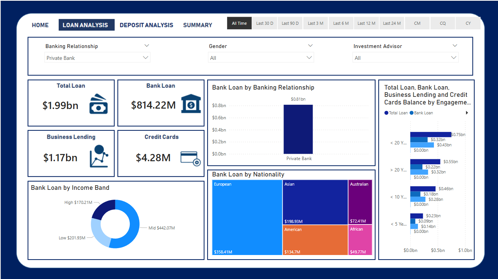
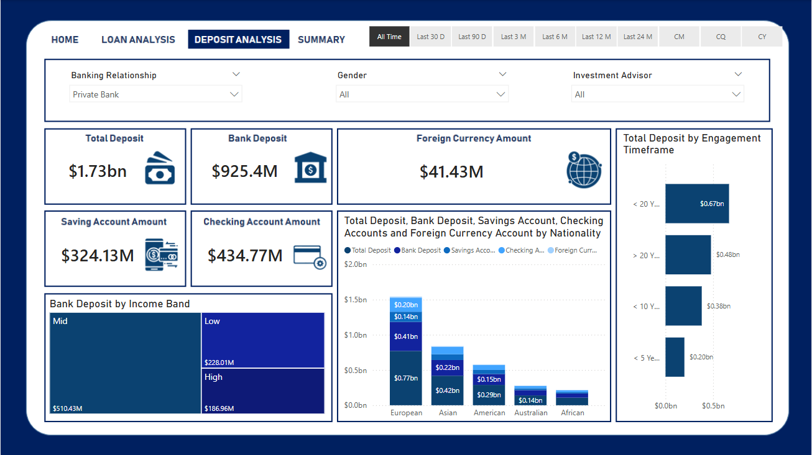

# 🏦 Retail Banking Analytics Dashboard
### Turning Banking Data into Actionable Business Insights

An end-to-end banking analytics project that explores customer demographics, loan distribution, deposits, and financial account balances through Python-based exploratory data analysis and an interactive Power BI dashboard.

The project demonstrates how raw banking data can be organized, analyzed, and presented to support data-driven decision-making in the retail banking sector.

---

## 📌 Project Overview

Banks manage large volumes of customer and financial data. Understanding this data can help identify customer segments, analyze lending and deposit patterns, and reveal relationships between different financial products.

This project examines banking customer data to uncover meaningful patterns across demographics, income, loans, deposits, and account balances. The analysis is presented through a four-page Power BI dashboard designed to make financial information easier to explore and interpret.

### 🎯 Business Objectives

- Analyze customer demographics and distribution.
- Explore loan patterns and customer financial profiles.
- Examine deposits and balances across different account types.
- Investigate relationships between financial account balances.
- Present findings through interactive, business-oriented visualizations.

---

## 🛠️ Technology Stack

| Technology | Purpose |
|---|---|
| **MySQL** | Relational data storage and data preparation |
| **SQL** | Data querying and analysis |
| **Python** | Exploratory data analysis |
| **Pandas & NumPy** | Data manipulation and numerical analysis |
| **Matplotlib & Seaborn** | Statistical visualization |
| **Power BI** | Interactive dashboards and business reporting |
| **DAX** | Calculated measures and analytical metrics, where implemented |

---

## 🔄 Project Workflow

```text
Raw Banking Dataset
        ↓
   MySQL Database
        ↓
Data Cleaning & Preparation
        ↓
Exploratory Data Analysis
        ↓
Financial Pattern Analysis
        ↓
Interactive Power BI Dashboard
        ↓
Business Insights & Interpretation
```

---

## 📂 Dataset Overview

The dataset contains **24 columns** describing customer demographics and financial information.

### Key analytical variables

- **Customer demographics:** Gender and nationality
- **Credit and lending:** Credit card balances and bank loans
- **Deposits:** Bank deposits and savings-related balances
- **Account information:** Checking, saving, and foreign currency accounts
- **Financial profile:** Estimated income and superannuation savings

The analysis focuses on understanding customer characteristics and relationships between financial variables.

---

## 🧹 Data Cleaning & Preparation

The project workflow includes the following preparation activities:

- Grouping income into **Low, Mid, and High** income bands.
- Standardizing categorical values for consistent analysis.
- Converting gender codes into readable labels:
  - `1` → Male
  - `2` → Female
- Replacing numeric branch codes with descriptive branch names.
- Preparing categorical and numerical variables for analysis and visualization.

These transformations make the data easier to interpret and support consistent reporting across dashboard pages.

---

## 📊 Exploratory Data Analysis

Python-based EDA is used to examine the dataset and investigate patterns in customer and financial information.

### Categorical analysis
- Gender distribution
- Nationality distribution
- Customer segmentation

### Numerical analysis
- Credit card balances
- Bank loans
- Bank deposits
- Checking account balances
- Saving account balances
- Estimated income
- Superannuation savings

Correlation analysis is also used to investigate how balances across different financial accounts move in relation to one another.

---

## 💡 Key Analytical Outcomes

### 1. Relationships Between Account Balances

The original analysis reports strong positive correlations between bank deposits, checking account balances, saving account balances, and foreign currency account balances.

**Business interpretation:** Customers with higher balances in one account category may also maintain higher balances in other account categories. This relationship can help analysts investigate customer financial profiles and opportunities for customer segmentation.

*Correlation indicates association, not causation.*

### 2. Customer Demographic Analysis

Analyzing gender and nationality helps describe the composition of the customer base and compare customer segments.

**Business application:** These comparisons can support customer profiling and help identify areas for further investigation.

### 3. Loan Portfolio Analysis

Examining bank loans and credit-related variables provides a view of lending patterns within the dataset.

**Business application:** Loan analysis can help stakeholders investigate how lending exposure varies across customer groups and financial profiles.

### 4. Deposit and Savings Analysis

Comparing deposits, checking accounts, savings accounts, and related balances provides insight into the distribution of customer funds across financial products.

**Business application:** These comparisons can support further analysis of deposit relationships and customer banking behavior.

> **Important:** These are analytical interpretations, not proof of causal relationships or specific business improvements. Numerical findings should be reported only after verifying the underlying calculations.

---

## 📈 Power BI Dashboard

The report contains four dashboard pages, each focused on a different aspect of the banking analysis.

### 1. 🏠 Home — Banking Overview


Provides an overview of the banking dataset through summary statistics and key visuals.

**Purpose:** Help users understand the overall customer and financial landscape before exploring individual areas.

### 2. 💳 Loan Analysis



Focuses on loan-related information and customer segments.

**Purpose:** Make lending patterns easier to examine and compare.

### 3. 💰 Deposit Analysis



Explores deposits and balances across different account categories.

**Purpose:** Help users compare account balances and investigate relationships between financial products.

### 4. 📋 Summary


Brings together key visuals and analytical themes from the report.

**Purpose:** Provide a consolidated view of the findings for easier interpretation.

---

## 📁 Repository Structure

```text
Retail-Banking-Analytics-Dashboard/
│
├── data/
│   └── Banking.csv
│
├── eda/
│   └── BankEDA.ipynb
│
├── powerbi/
│   ├── Banking Dashboard.pbix
│   ├── page1_home.png
│   ├── page2_loan_analysis.png
│   ├── page3_deposit_analysis.png
│   └── page4_summary.png
│
└── README.md
```


---

## 🎓 Skills Demonstrated

- Exploratory data analysis
- Data cleaning and categorical standardization
- SQL and relational database concepts
- Statistical and correlation analysis
- Data visualization
- Power BI dashboard design
- Translating analytical observations into business interpretations
- Organizing an analytics project for reproducibility and presentation

---

## 🔮 Potential Future Enhancements

- Add documented SQL scripts for database creation, validation, cleaning, and analysis.
- Add automated data-quality checks for missing values, duplicates, and invalid categories.
- Include verified KPIs and numerical findings in the README.
- Add customer segmentation based on financial characteristics.
- Improve dashboard interactivity with appropriate slicers, drill-through pages, and tooltips.
- Document refresh procedures and reproducible database setup.


---

### ⭐ Project Summary

**Retail Banking Analytics Dashboard** brings together banking data, exploratory analysis, and business intelligence to examine customer demographics, lending patterns, deposits, and account balances.

It demonstrates an analytics workflow from data exploration to visual reporting, with opportunities to extend the project through independently developed SQL analysis, data-quality validation, and deeper business insights.
